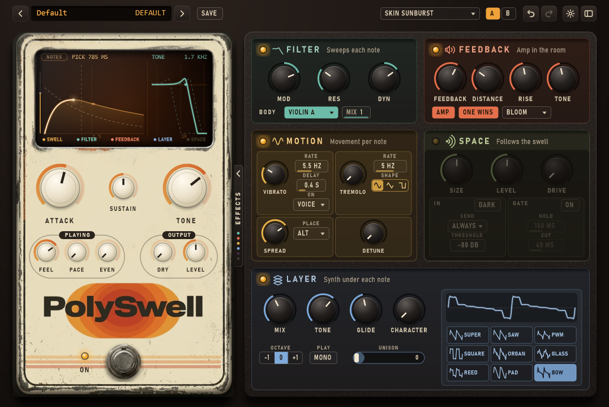

# PolySwell II

A polyphonic swell and sustain pedal as a plugin (VST3 on Windows and macOS, plus Audio Unit on macOS).
Every note you play swells in on its own and rings out as long as you like. It's made for smooth lead lines,
ambient pads and "amp in the room" feedback. The swell is modelled on a measured EHX POG2.



**Download page:** see the repository's GitHub Pages site, or grab the zips under
[Releases](../../releases/latest).

## Features
- Per-note swell (ATTACK, SUSTAIN, TONE), shaped by how you play (FEEL, PACE, EVEN), with MATCH for level-matched swells.
- Effects panel, all note-aware: FILTER, FEEDBACK (amp in the room), MOTION, LAYER (a synth under each note), SPACE.
- A live signal window showing each note you play, and a picture of what each knob does as you turn it.
- Four skins (Sunburst, Lagoon, Midnight, Sunburst Night), undo/redo, A/B compare, MIDI learn, presets for Lead / Pad / Feedback.

## Install (no building needed)
Download the zip for your system from [the latest release](../../releases/latest):

| System | File | Install |
|---|---|---|
| Windows 10/11 | `PolySwell-II-Windows.zip` | Copy `PolySwell II.vst3` to `C:\Program Files\Common Files\VST3` |
| macOS 10.13+ (Apple Silicon and Intel) | `PolySwell-II-macOS.zip` | Double-click `install-mac.command` |

Each zip has an `INSTALL.txt` with the details.

**Mac note:** PolySwell II is free and not notarised by Apple (that needs a paid developer account), so macOS blocks
it the first time. `install-mac.command` clears that for you. You can also do it by hand in Terminal:

```bash
xattr -dr com.apple.quarantine ~/Library/Audio/Plug-Ins/VST3/PolySwell\ II.vst3 ~/Library/Audio/Plug-Ins/Components/PolySwell\ II.component
```

## Build it yourself
You need CMake 3.22+ and a C++17 compiler: Visual Studio 2022 on Windows, Xcode (or its command line tools) on macOS.
JUCE 8 is downloaded automatically.

```bash
cmake -B build -DCMAKE_BUILD_TYPE=Release
cmake --build build --config Release --target PolySwell_VST3
```

- On a Mac, also build `PolySwell_AU`. Add `-DCMAKE_OSX_ARCHITECTURES="arm64;x86_64"` to the first line for a universal binary.
- The plugin ends up in `build/PolySwell_artefacts/Release/`.
- DSP tests: `cmake --build build --config Release --target engine_test`, then run `engine_test`.
- Windows shortcut: `.\build.ps1 engine_test PolySwell_VST3`, then `.\install.ps1` from an administrator PowerShell.

## Releasing a new version (maintainer)
Push a tag and GitHub Actions builds both systems and publishes the release:

```bash
git tag v2.0.0
git push origin v2.0.0
```

## Licence
GNU AGPLv3 (see [LICENSE](LICENSE)). It's built with [JUCE](https://juce.com), used under its AGPLv3 option.
VST is a trademark of Steinberg Media Technologies GmbH.
